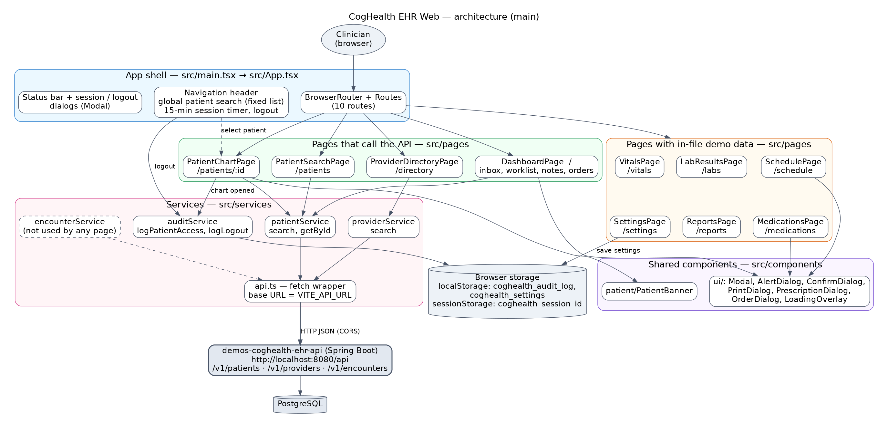

# Architecture

CogHealth EHR Web is a single-page React app (Vite, TypeScript, Tailwind CSS) that renders a Windows-XP-styled clinical workstation. It has no auth flow of its own: the signed-in user ("Dr. Sarah Anderson") is fixed in the UI. Four pages read data from the [CogHealth EHR API](https://github.com/COG-GTM/demos-coghealth-ehr-api); the other six render demo data defined in their own files.

The diagram source is [`diagrams/architecture.dot`](diagrams/architecture.dot) (Graphviz). After editing it, run `docs/diagrams/render.sh` (needs `graphviz`) to regenerate `architecture.png` and `architecture.svg`.

## App shell

`index.html` loads `src/main.tsx`, which mounts `src/App.tsx` in `StrictMode`. `App.tsx` holds everything outside the pages:

- **Routing:** a `BrowserRouter` with ten routes (below). Every route is rendered inside the same header and status bar.
- **Navigation header:** the menu links, a global patient search box, the session timer and the logout button. The global search filters a fixed list of six patients defined in `App.tsx`, not the API, and opens `/patients/:id` for the one selected.
- **Session timeout:** a 15-minute inactivity timer, reset by any click or key press. At 2 minutes left it shows a warning dialog; at zero it shows "Session Expired" and then logs out.
- **Logout:** a confirm dialog, then `auditService.logLogout()` (`LOGOUT` or `SESSION_TIMEOUT`) and a page reload.
- **Status bar:** static indicators (HIPAA Compliant, TLS 1.3, Audit Logging, Database Connected). They are labels only and do not reflect live state.

## Pages (`src/pages`)

| Route | Page | Data source |
|---|---|---|
| `/` | `DashboardPage` (inbox, patient worklist, unsigned notes, pending orders, critical alerts) | `patientService.search('')`; inbox and worklist rows are generated from the first 20 patients returned |
| `/patients` | `PatientSearchPage` (patient list, filters, detail pane) | `patientService.search(query)` |
| `/patients/:id` | `PatientChartPage` (banner, demographics, tabs) | `patientService.getById(id)` for the patient; problems, medications, allergies, encounters, vitals and labs are in-file demo data |
| `/directory` | `ProviderDirectoryPage` (search providers by last name) | `providerService.search(lastName)` |
| `/schedule` | `SchedulePage` | In-file demo appointments |
| `/labs` | `LabResultsPage` | In-file demo lab panels |
| `/vitals` | `VitalsPage` | In-file demo vitals |
| `/medications` | `MedicationsPage` | In-file demo medication orders |
| `/reports` | `ReportsPage` | In-file demo reports and metrics |
| `/settings` | `SettingsPage` | `localStorage` key `coghealth_settings` |

Pages keep their own state with React `useState`/`useEffect` and call the services directly. There is no global store or query cache: `zustand` and `@tanstack/react-query` are listed in `package.json` but nothing in `src/` imports them, and there is no `src/stores/` directory.

When an API call fails, the Patients page shows a "Failed to load patients from server" alert, the Directory page shows an inline error, the Dashboard logs to the console and renders empty panels, and the Patient Chart stays on "Loading patient...".

## Shared components (`src/components`)

- `ui/Modal.tsx` exports `Modal`, `AlertDialog` and `ConfirmDialog`, used for every dialog in the app.
- `ui/PrintDialog.tsx`, `ui/PrescriptionDialog.tsx` (e-Prescribe) and `ui/OrderDialog.tsx` (Order Labs / imaging) are opened from the Dashboard, Patients, Patient Chart, Schedule and Medications pages. Submitting them only updates the page and shows a confirmation; nothing is sent to the API.
- `ui/LoadingOverlay.tsx` covers the API-backed pages while a request is in flight.
- `patient/PatientBanner.tsx` is the header of the patient chart.
- `ui/Button`, `ui/Input`, `ui/Badge`, `ui/Card` and `patient/PatientSearch` are exported but no page uses them.

## Services (`src/services`)

- `api.ts` wraps `fetch` with JSON headers, query-string building and an error on non-2xx responses. The base URL is `VITE_API_URL`, default `http://localhost:8080/api`.
- `patientService`: `GET /v1/patients/search?q=&page=&size=` (Spring `Page` response), `GET /v1/patients/{id}`, plus `getByMrn`, `create` and `update`, which no page calls.
- `providerService`: `GET /v1/providers/search?lastName=`, plus `getAll`, `getById`, `listDepartments` and `listSpecialties`, which no page calls.
- `encounterService`: wrappers for `/v1/encounters/*`; no page imports it.
- `auditService`: writes audit events to `localStorage` (`coghealth_audit_log`, newest first, capped at 1,000) with a per-tab session id in `sessionStorage` (`coghealth_session_id`). Only two events are recorded today: `PATIENT_ACCESS` when a chart loads and `LOGOUT`/`SESSION_TIMEOUT`. The other helpers (`logPatientSearch`, `logPHIView`, `logPrint`, `logPrescription`, `logOrder`) are not called. Nothing is sent to the API.

Types for the API payloads live in `src/types` (`Patient`, `Provider`, `Encounter`, medication, lab and vitals types).

## Backend

The API is the Spring Boot app in [demos-coghealth-ehr-api](https://github.com/COG-GTM/demos-coghealth-ehr-api), served on port 8080 under the `/api` context path and backed by PostgreSQL (Flyway migrations seed sample patients and providers). Its CORS config allows `http://localhost:5173`, `:5178` and `:3000`, so run the web app on one of those origins.

## Build and tests

- `npm run dev` starts Vite on http://localhost:5173.
- `npm run build` runs `tsc -b` and `vite build` into `dist/`.
- `npm run lint` runs ESLint.
- `npm test` runs Jest. The only suite is `tests/e2e.test.ts`, a Puppeteer walk-through of the UI that expects the dev server on http://localhost:5173 (and the API for the data-backed pages). CI (`.github/workflows/ci.yml`) runs lint, build and `npm test -- --testPathIgnorePatterns=e2e --passWithNoTests`, so it runs no tests. `npm run test:e2e` fails on Jest 30 (`--testPathPattern` was renamed `--testPathPatterns`); run `npx jest --testPathPatterns=tests/e2e` instead. The suite has no test for the provider directory.
- `test-ui.js` / `test-ui.cjs` are standalone Puppeteer scripts that check the classic styling.
